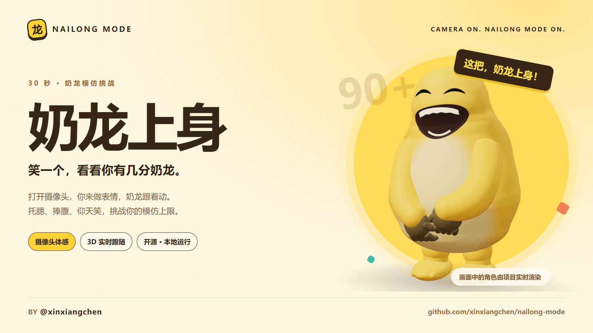
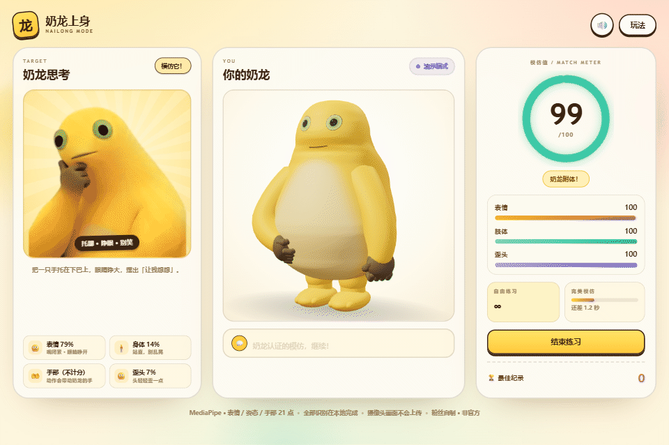
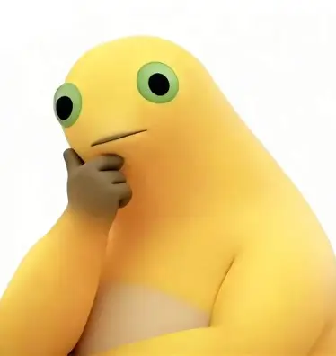

<div align="center">
  
  <h1>奶龙上身 · Nailong Mode</h1>
  <p><strong>笑一个，看看你有几分奶龙。</strong></p>
  <p>一个用摄像头玩的 3D 奶龙模仿小游戏。你负责表演，奶龙负责上身。</p>
  <p>
    <a href="https://github.com/xinxiangchen/nailong-mode/actions/workflows/ci.yml"></a>
    <a href="LICENSE"></a>
    
  </p>
  <p>
    <a href="https://github.com/xinxiangchen/nailong-mode/archive/refs/heads/main.zip"><strong>下载开玩</strong></a> ·
    <a href="#快速开始">启动指南</a> ·
    <a href="docs/DEVELOPMENT.md">开发文档</a> ·
    <a href="https://github.com/xinxiangchen/nailong-mode/issues">反馈问题</a>
  </p>
  <sub>Made by <a href="https://github.com/xinxiangchen">@xinxiangchen</a> · 非官方同人项目</sub>
</div>

---

## 先看奶龙上身

托腮的时候，奶龙跟着想；张嘴大笑，奶龙跟着笑。摄像头读取你的表情、上半身姿势和手指动作，驱动一只会动的 3D 小黄龙。



<p align="center"><sub>项目内置演示模式的实际运行画面。无摄像头也能先看演示。</sub></p>

## 三种姿势，你是哪一款？

<table>
  <tr>
    <td align="center" width="33%"><br><strong>01 · 我在思考</strong><br><sub>单手托腮，睁眼闭嘴。<br>越一本正经，越有那味。</sub></td>
    <td align="center" width="34%"><br><strong>02 · 笑到捧腹</strong><br><sub>双手捧肚，张嘴笑眼。<br>忍住？这把根本忍不住。</sub></td>
    <td align="center" width="33%"><br><strong>03 · 仰天大笑</strong><br><sub>双手抱头，放声大笑。<br>把这局的快乐值拉满。</sub></td>
  </tr>
</table>

**一局 30 秒，保持 90 分以上 2 秒，触发「完美模仿」。** 每个挑战都有独立最佳纪录，也可以进入不限时练习。

## 不只会笑，还真的跟你动

| 你做什么 | 奶龙怎么跟 |
| :--- | :--- |
| 张嘴、咧嘴、眯眼 | 大嘴和笑眼实时变化 |
| 转头、仰头、歪头 | 头颈跟随，带动整张脸 |
| 抬臂、抱头、双手捧肚 | 两节手臂 IK 跟随动作 |
| 张手、握拳、弯手腕 | 双手关节和手指跟着动 |

- **打开就能玩**：模型和运行库随项目提供，无需 API Key、账号登录或前端构建。
- **镜头留在本地**：视频在浏览器内处理，不上传、不录制。
- **跟朋友比一把**：三种挑战、实时分项反馈、S / A / B / C / D 结算评级。
- **没摄像头也能逛**：内置自动演示；WebGL 不可用时回退到 2D 角色。

## 快速开始

需要 **Python 3.10+** 和 **Chrome / Edge**，推荐电脑摄像头。运行游戏不需要安装 Node.js。

### Windows：下载，解压，双击

1. [下载项目 ZIP](https://github.com/xinxiangchen/nailong-mode/archive/refs/heads/main.zip)，解压到本地文件夹。
2. 双击 **`启动奶龙.bat`**，浏览器会自动打开游戏。
3. 选择挑战，点击开始，允许摄像头权限。准备好——奶龙上身！

默认地址：[http://127.0.0.1:8899](http://127.0.0.1:8899)。结束服务可双击 `停止奶龙.bat`。

### macOS / Linux / 命令行

```bash
git clone https://github.com/xinxiangchen/nailong-mode.git
cd nailong-mode
python3 server.py
```

Windows 命令行使用 `python server.py`。打开终端输出的本地地址即可。

> 请通过启动脚本或 Python 服务打开游戏。直接双击 `index.html` 无法正常使用摄像头与本地模块。

## 玩得更顺一点

- 让脸、肩膀、手肘和手腕都在画面里，光线尽量均匀。脸太小时，游戏会提示靠近一点。
- 笑得自然就行：大笑挑战不要求把嘴撑到极限，也不要求挑眉。
- 「显示骨架」可以查看当前识别到了哪些关节点，练习模式适合慢慢找姿势。
- 手指识别不计分。捧腹和抱头需要看清两侧手臂，否则总分最高 85；思考主要看表情。
- 不同摄像头、光照和遮挡会影响识别效果。遇到问题，欢迎在 [Issues](https://github.com/xinxiangchen/nailong-mode/issues) 里描述设备和复现动作。

## 一起把它玩出花

想改动作、换评分规则、优化建模？欢迎提 Issue 和 Pull Request。

- [开发与实现说明](docs/DEVELOPMENT.md)：识别流程、骨骼、IK、评分和常见问题。
- [内容发布素材包](docs/SHARING.md)：封面、演示动图，以及可自行改写的标题和文案。
- `js/challenges.js`：挑战与目标配置。
- `js/scoring.js`：评分规则。
- `js/nailong3d.js`：3D 建模、蒙皮和动画。

开发测试需要 Node.js 20+，无需额外 npm 依赖：

```bash
npm test
```

GitHub Actions 在 Windows / Linux 上自动检查识别指标、评分、脸部裁剪及代码语法。

## 开源与素材

原创源码采用 [MIT License](LICENSE)。第三方运行库与模型保留各自许可，详见 [第三方说明](THIRD_PARTY_NOTICES.md)。

「奶龙」名称、角色形象、参考图片及截图中的相关素材权利归原权利人所有，不在源码 MIT 授权范围内。本项目为非官方同人作品，与版权方无关联。

---

<p align="center"><strong>这把，奶龙上身。</strong><br><sub>如果它让你笑了一下，欢迎点个 Star，把快乐传给下一个人。</sub></p>
